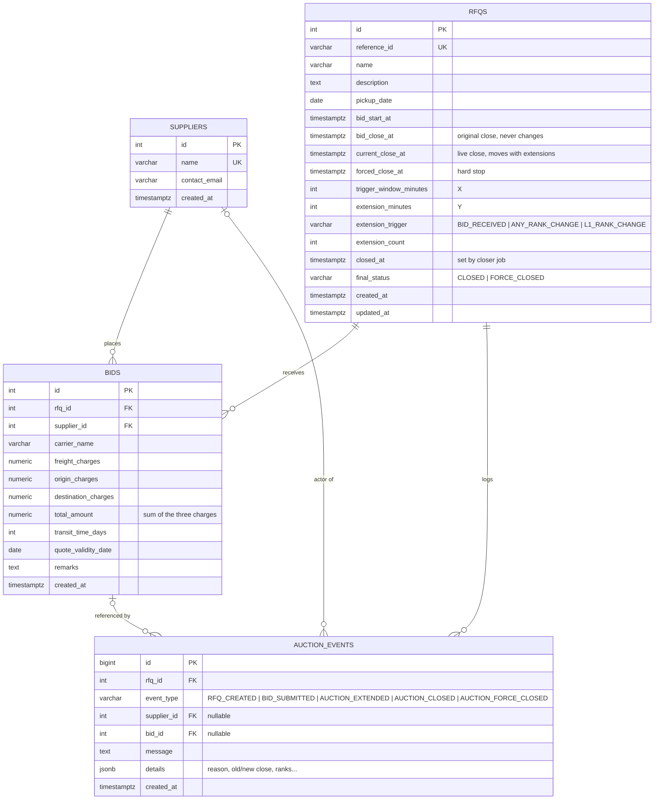

# Database Schema: RFQ British Auction
`Just added ER diagram due to time constraint`  
PostgreSQL database, managed by Alembic (`backend/alembic/versions/0001_initial_schema.py`).
There are 4 tables. All timestamps are `timestamptz`, and money is `NUMERIC(14,2)`.

## ER diagram

