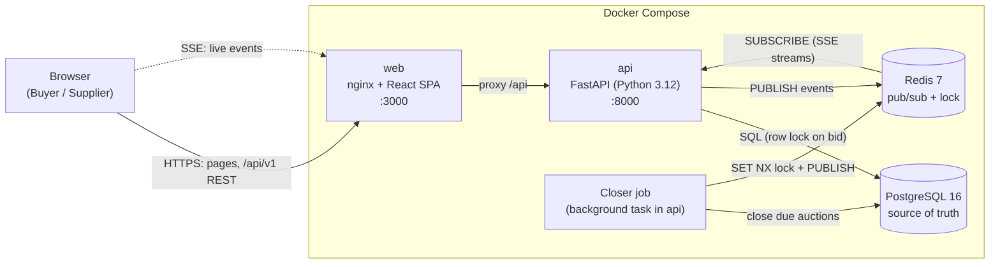
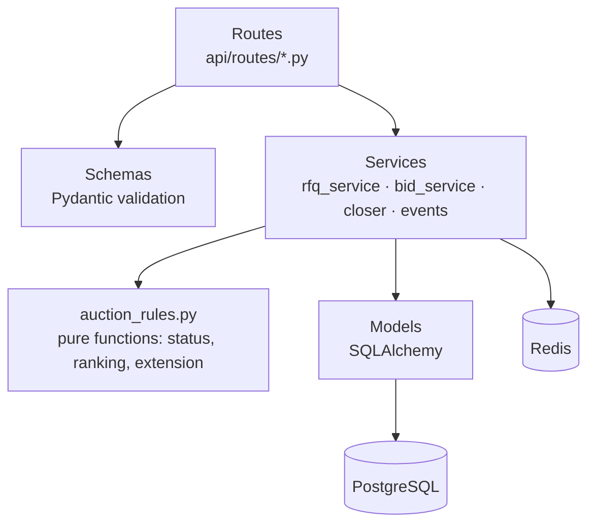

# High-Level Design: RFQ British Auction

_generated using online mermaid editor_

## 1. Overview

A simplified RFQ (Request for Quotation) system where suppliers compete in a **British
(reverse) auction**: they submit quotes openly and keep lowering them.

- Bidding activity near the close **extends** the auction automatically.
- The auction can never run past a **forced close time**.
---
## 2. Architecture

## 3. Backend layers

